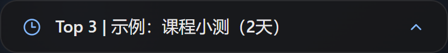
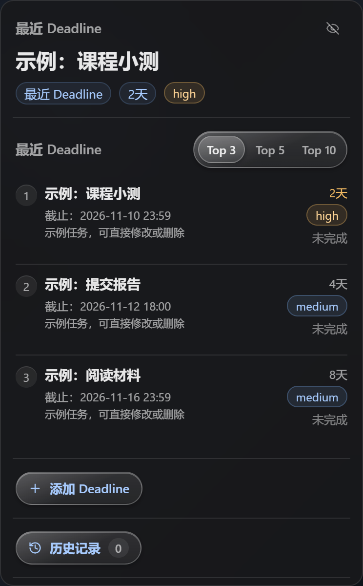

# Deadline Panel

[中文](README.md) | English

Deadline Panel is an ADHD-friendly, always-on desktop deadline board for Windows / macOS.

It is a low-distraction, always-visible environmental cue: a small information strip stays in the lower-right corner of your screen and reminds you what you are doing now, what the nearest deadline is, and how much time is left.

| Collapsed strip | Expanded panel |
| --- | --- |
|  |  |

## Core Goal

It is designed to avoid common problems in traditional to-do apps:

- Showing a long to-do list
- Making import and categorization complicated
- Making it easy to forget tasks that have already been added
- Letting the current task disappear from attention once interrupted
- Becoming bloated and cumbersome
- Depending on frequent intrusive notifications

Deadline Panel uses only a persistent visual cue, so while you are using your computer, you are less likely to forget your most important current task and its deadline.

## Main Features

- Supports Chinese / Japanese / English
- Floating desktop information strip in the lower-right corner
- Automatically expands into a full panel when the mouse moves near it
- Always on top, and automatically hides when a fullscreen window exists
- Supports dragging to change position
- Supports launch at startup
- Local SQLite data storage
- Top 3 / 5 / 10 focused task display
- History view and restore
- Quick add with natural-language parsing
- Command import preview
- JSON import and export
- Optional Supabase cloud sync

## Installation

Download an installer from [Releases](https://github.com/xy-tsuki/deadline-panel/releases): `*_x64-setup.exe` for Windows, `*-macOS-arm64.dmg` for macOS (Apple Silicon).

## Development

Requires Node.js and Rust (see the [Tauri prerequisites](https://v2.tauri.app/start/prerequisites/)).

```bash
npm install
npm run tauri:dev   # run the desktop app in development mode
npm test            # run tests
npm run tauri:build # build a release
```

## Command Import Format

Supports importing `"/add"` commands generated by ChatGPT / Gemini / other tools:

```text
/add title="Graph Mining Quiz" due="2026-06-23 23:59" priority="high" notes="LMS"
```

Before importing, Deadline Panel shows a preview list. You can edit the title, due time, priority, and notes, and you can remove entries that you do not want to import.

## Supabase Cloud Sync

Since version 0.4.0, Deadline Panel supports optional Supabase sync-code cloud sync.

Steps:

1. Generate a sync code in "Settings & Tools" on the first device.
2. Copy the sync code.
3. Paste the same sync code on another device.
4. Click "Sync Now" to perform the first merged sync.
5. Advanced users can also use their own Supabase project.

## Tech Stack

- React
- TypeScript
- Vite
- Tauri
- SQLite
- Zustand

## License

GPL-3.0
